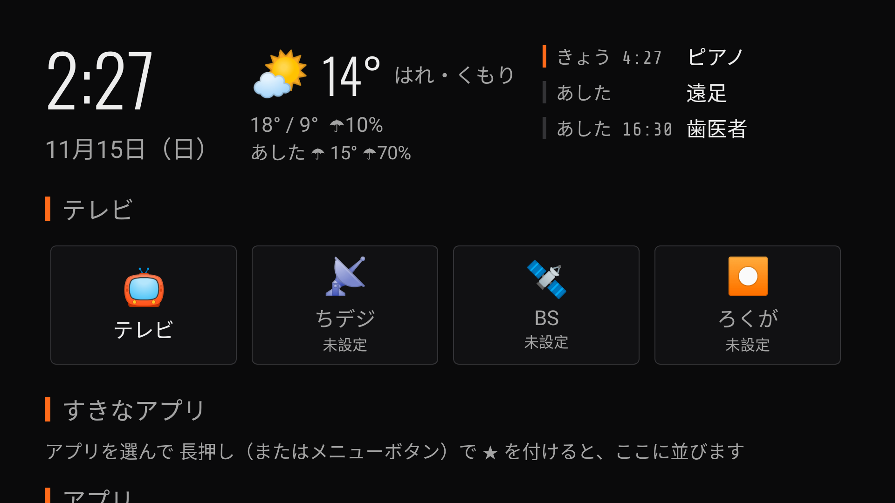

# Theta TVhome Hatch

Android TV 用の、**広告もおすすめも出ない**軽いホーム画面。子どもでもリモコンで迷わず選べることを目指します。
Theta Hatch シリーズの 1 つ（シリーズの決まりは [Theta.Hatch.Series](https://github.com/kiwiman0706-beep/Theta.Hatch.Series)）。

対象：SHARP AQUOS 4T-C65DQ2（2021 年、Android TV）。ほかの Android TV でも動く作り。

## できること（0.1.0）

| | |
| --- | --- |
| 時計・天気・予定 | 天気は Open-Meteo（キー不要）。予定は Google カレンダーの「iCal 形式の非公開 URL」（秘密として暗号化して保存） |
| テレビの入口 | テレビ・地デジ・BS・録画・HDMI。HDMI は Android TV の決まった方法で切り替え。地デジ・BS・録画は機種ごとに違うので ADB で設定（[docs/ADB.md](docs/ADB.md)） |
| アプリ | すきなアプリ（★）を大きく、ほかは下に。長押しかメニューボタンで ★・並べ替え・かくす |
| 子どもモード | すきなアプリとテレビだけを出す。設定・更新・ぜんぶのアプリは「おうちの人の番号」で |
| 自動更新（ハブ） | このホームと、テレビに入れた Hatch のアプリを 12 時間ごとに確かめ、共通の鍵・SHA-256 を照合して更新 |
| 設定のハブ | `content://app.thetahatch.tvhome.theta`（スキン・NAS の接続先など。シリーズのアプリだけが読める） |
| ADB の窓口 | 状態（dumpsys）、テレビの入口を調べる（PROBE）、設定（SET・SET_SECRET）、試しに開く（LAUNCH） |

## 入れ方

1. 最初の 1 本は ADB で入れる：[docs/ADB.md](docs/ADB.md)
2. その後は自動で更新（Releases の最新版。リモコンで「こうしん」からも）
3. 様子を見て、既定のホームに切り替える（同じく docs/ADB.md。元に戻す手順つき）

## これから

[docs/ROADMAP.md](docs/ROADMAP.md)（NAS・USB HDD・Hatch アプリとの連携・家族のビデオ通話・SwitchBot・Tapo カメラ）

## 開発

- Kotlin・Jetpack Compose（foundation だけ）・WorkManager。minSdk 28
- `./gradlew :app:testDebugUnitTest :app:lintDebug :app:assembleDebug`
- 版を上げて main に push → Actions がタグと Release を作る（共通の鍵で署名、`ThetaTVhomeHatch-<版>.apk`）
